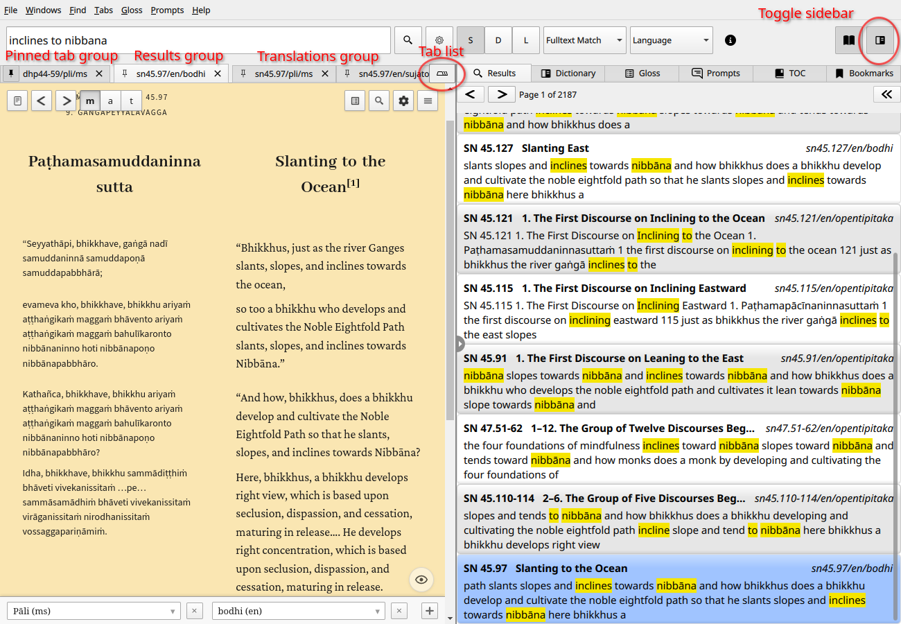
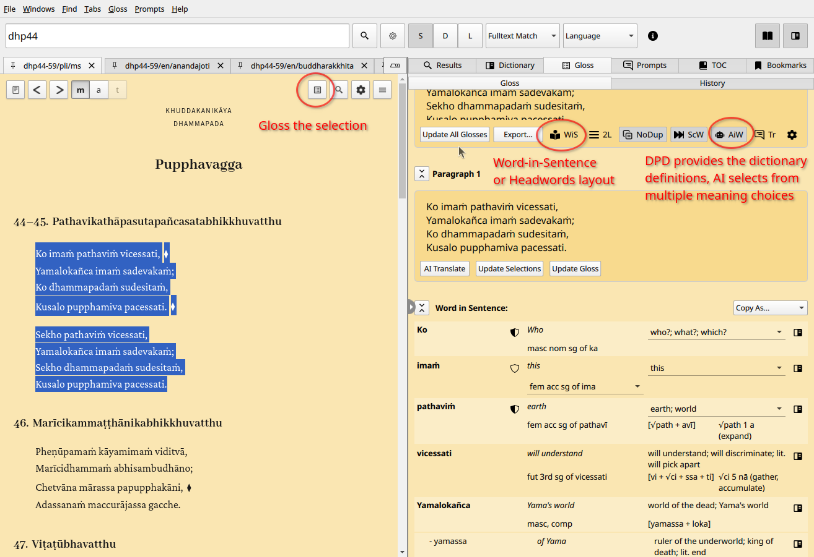

# Simsapa Dhamma Reader

A sutta reader and Pāli dictionary application. Feature highlights:

- [Fulltext search](https://simsapa.github.io/features/search-queries/) with Pāli declension matching
  + Suttas, commentaries, dictionaries and a book library
- [Search result filtering](https://simsapa.github.io/features/app-windows/#search-result-filtering) options
- [Reading layout](https://simsapa.github.io/features/app-windows/#reading-layout-display-settings): line-by-line or side-by-side columns with multiple translations
- [Pāli text gloss analysis](https://simsapa.github.io/features/app-windows/#gloss-tab) with export formats
- [Extensions and plugins](https://github.com/simsapa/simsapa-extensions-and-plugins) for browsers and note taking app
- [Command line interface](https://simsapa.github.io/features/cli-localhost-api/) (`@simsapa/cli` npm package) for humans and AI agents

Download from the [Releases](https://github.com/simsapa/simsapa/releases) page for Linux, MacOS, Windows.
For Android, install from from the [Play Store](https://play.google.com/store/apps/details?id=io.github.simsapa.app) 
or using the .apk download.

Installation guides: [Linux](https://simsapa.github.io/install/linux/) / [MacOS](https://simsapa.github.io/install/macos/) / [Windows](https://simsapa.github.io/install/windows/).

On the first run, it downloads the application database and fulltext index.
After the database download, the application works offline.





## Command-line tool: `@simsapa/cli`

`simsapa` is the command-line version of the app's data engine: search the
suttas and the Pāli dictionaries from the terminal, gloss Pāli text, import
dictionaries and books, and serve the Simsapa localhost HTTP API, without the
desktop app. Every command prints plain text, or one JSON document with
`--json`, so it suits agents as well as people.

Install it from npm (Node.js 18 or later) and download the databases:

```sh
npm install -g @simsapa/cli
simsapa setup
simsapa install-skill
```

Supported platforms: Linux x64 and arm64, macOS on Apple Silicon, and Windows
x64. The databases take about 4.8 GB on disk. The CLI uses the same data folder
as the desktop app, so if the app is already set up, there is no need to run
`simsapa setup`.

`simsapa --help` lists the commands, and `simsapa docs` prints the full CLI and
localhost API reference. See [npm/cli/README.md](npm/cli/README.md) for more.

To let a coding agent (Claude Code, OpenCode or Pi) use the CLI, install the
agent skills. `simsapa` tells the agent when and how to search the suttas and
look up Pāli words; `gloss-pali-passage` makes a word-by-word analysis document
(`/gloss-pali-passage dhp23`). They are also installed as slash commands for
Claude Code and OpenCode, and need no databases:

```sh
simsapa install-skill --agent claude --global   # every project
simsapa install-skill --agent claude --local    # the current folder only
simsapa install-skill                           # finds agent folders, asks
```

## Building

### Prerequisites

- Qt 6.9.3
- Rust (latest stable)
- CMake 3.24+
- Platform-specific build tools

### Development Build

```bash
# Build the project
make build -B

# Run the application
make run
```

### Distribution Packages

#### Linux AppImage

```bash
# Build AppImage
make appimage -B

# Or with custom options
./build-appimage.sh --app-version v0.2.0 --os-suffix -ubuntu24

# Clean rebuild
make appimage-rebuild
```

#### macOS .app and DMG

```bash
# Build both .app bundle and .dmg
make macos -B

# Or build only .app bundle (skip DMG creation)
make macos-app

# Clean rebuild
make macos-rebuild
```

The macOS build will:
- Create a properly bundled .app in `./dist/Simsapa.app`
- Bundle all Qt frameworks and dependencies using `macdeployqt`
- Create a styled DMG installer: `Simsapa-vX.X.X-{arch}.dmg`

**Note:** For distribution, you may want to code sign the app. Set the `APPLE_SIGNING_IDENTITY` environment variable:

```bash
export APPLE_SIGNING_IDENTITY="Developer ID Application: Your Name (TEAM_ID)"
make macos
```

#### Android APK

Build using Qt Creator with the Android kit configured.

### Testing

```bash
# Run all tests
make test

# Individual test suites
make rust-test   # Backend tests
make qml-test    # QML tests
make js-test     # JavaScript tests
```
